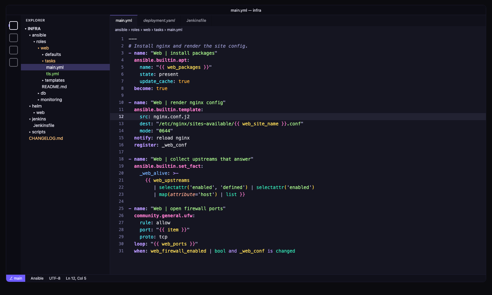
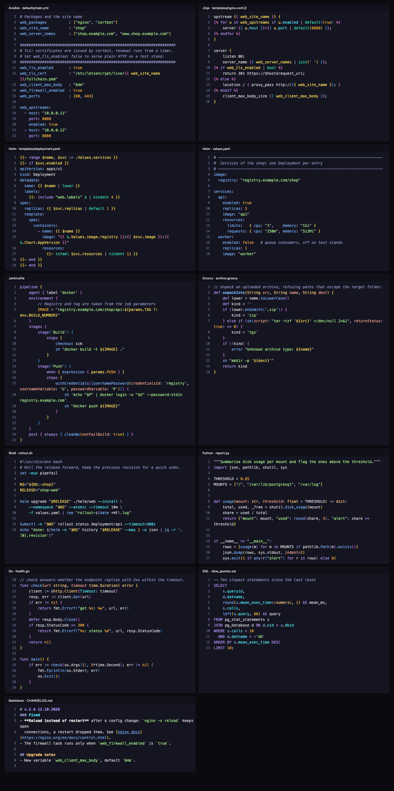
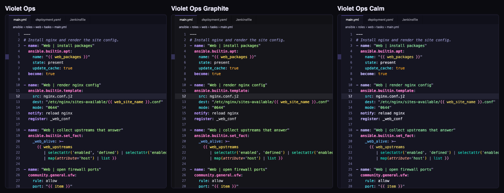

# Violet Ops

A violet dark theme for VS Code built for the code DevOps engineers read all day: Ansible roles, Jinja templates,
Helm charts, Jenkins pipelines, shell, Go, Python and SQL.



## What it does differently

**Ansible tasks read at a glance.** The Red Hat Ansible extension tells the editor what each key means.
Violet Ops gives every meaning its own color:

| What | Example | Color |
|---|---|---|
| Module | `ansible.builtin.template` | pink, bold |
| Documented module parameter | `src`, `dest`, `mode` | cyan |
| Task keyword | `name`, `when`, `loop`, `register`, `become` | violet, bold |
| Other keys, variables in defaults and vars | `web_site_name` | blue |
| Variable inside `{{ }}` | `{{ web_ports }}` | yellow |
| Jinja filter or test | `\| default`, `\| selectattr` | green-teal |

A side effect: the language server colors only parameters that the module documents. A misspelled parameter
stays blue among cyan ones, so the typo is visible before you run the playbook.

**Jenkinsfiles are not a white wall.** VS Code's Groovy grammar does not know the Jenkins DSL. The theme ships a small
injection grammar: pipeline blocks (`pipeline`, `stages`, `stage`, `steps`, `post`, `when`) are violet,
steps (`sh`, `checkout`, `withCredentials`, `junit`…) are blue, `env.`, `params.` and `currentBuild.` are yellow.

**Helm templates without a wall of bold.** Template actions, `.Values` and `$variables`, Sprig functions and
`{{ }}` delimiters are colored separately. Many themes paint the whole `{{ … }}` scope bold; this one does not.

**High contrast, no neon soup.** Every code color is at least 7:1 against the background (WCAG 2), plain text is
a neutral light grey so colored roles stand out, and roles that sit next to each other differ in hue,
not only in lightness. Task keywords and modules are also bold, which helps with color blindness.



## Variants

- **Violet Ops** — the main theme: bright palette on a deep violet background.
- **Violet Ops Graphite** — the same colors on a neutral graphite background.
- **Violet Ops Calm** — a muted palette for long evenings.



## Install

- **VS Code, Cursor, VSCodium, Windsurf:** search for **Violet Ops** in the Extensions view
  ([Open VSX](https://open-vsx.org/extension/drxinfra/violet-ops)).
- **Offline or behind a proxy:** download the `.vsix` from
  [drxinfra.ru](https://drxinfra.ru/violet-ops.html) or the
  [GitHub releases](https://github.com/drxinfra/violet-ops/releases) and run
  `code --install-extension violet-ops-1.0.0.vsix`.

Then pick the theme: `Ctrl+K Ctrl+T` (`Cmd+K Cmd+T` on macOS) → **Violet Ops**.

### Recommended setup

- [Ansible](https://marketplace.visualstudio.com/items?itemName=redhat.ansible) by Red Hat: without it YAML is just
  YAML and modules look like any other key. Check the language in the status bar says **Ansible**.
  If your roles are not detected, associate them, for example:
  ```json
  "files.associations": {
    "**/roles/**/*.yml": "ansible",
    "**/playbooks/*.yml": "ansible"
  }
  ```
- [Kubernetes](https://marketplace.visualstudio.com/items?itemName=ms-kubernetes-tools.vscode-kubernetes-tools)
  for the `helm` language in `templates/`.
- A font with a medium weight reads better on a dark background, for example JetBrains Mono with
  `"editor.fontWeight": "500"`.

### Only want the Ansible colors in your own theme?

```json
"editor.semanticTokenColorCustomizations": {
  "rules": {
    "class:ansible":   { "foreground": "#FF7ED0", "bold": true },
    "method:ansible":  "#52F0FF",
    "keyword:ansible": { "foreground": "#B897FF", "bold": true },
    "property:ansible": "#7AB4FF"
  }
}
```

Keep the `:ansible` suffix: without it the same rules repaint classes and methods in Python, Go and every other
language with semantic highlighting.

## Building from source

The palette, the checks and the packaging live in `build.py`:

```sh
cd render && npm install && cd ..
python3 -I build.py            # themes, contrast checks, .vsix, previews
python3 -I build.py --no-preview
```

The build fails if any code color drops below 7:1 against the background. Previews in `preview/` are rendered by
the same TextMate engine VS Code uses (`vscode-textmate` + `vscode-oniguruma`) with the grammars of your installed
extensions, so they need Node.js, Google Chrome and VS Code with the Ansible and Kubernetes extensions.
The sample files in `samples/` are made up for the screenshots.

## Русский

Тёмная фиолетовая тема для кода, который DevOps-инженер читает весь день: роли Ansible, шаблоны Jinja, чарты Helm,
пайплайны Jenkins. В задачах Ansible модуль, параметр, ключ задачи и переменная окрашены по-разному, поэтому опечатка
в параметре видна сразу. Подробности и скачивание `.vsix`: [drxinfra.ru/violet-ops.html](https://drxinfra.ru/violet-ops.html).

## License

MIT © drxinfra
